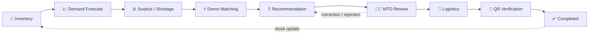
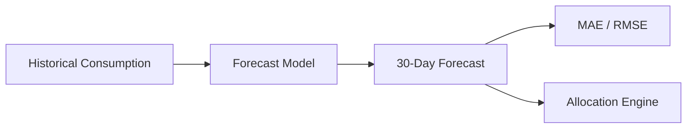
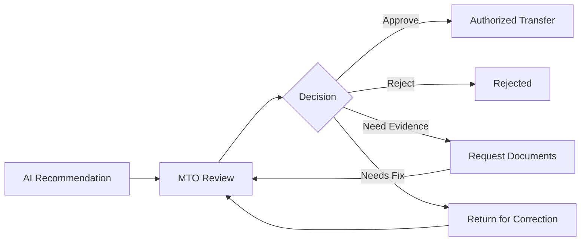
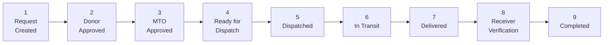
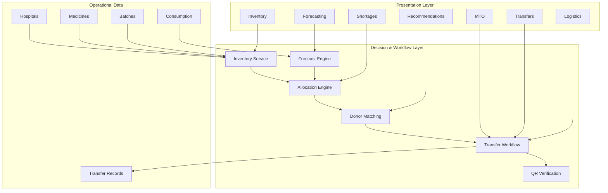

<div align="center">

# 💊 DoseRelay

### Intelligent Medicine Redistribution Across Healthcare Networks

**Forecast demand · Detect shortages · Match surplus · Approve safely · Transfer with traceability**

`AI-assisted decision support` · `Inventory intelligence` · `MTO approvals` · `QR-backed chain of custody`

<br>

**DoseRelay helps healthcare networks move the right medicine, from the right hospital, to the right place — before stock expires in one facility or runs short in another.**

<br>

[Overview](#-overview) · [How It Works](#-how-doserelay-works) · [Architecture](#-system-architecture) · [Modules](#-core-modules) · [Transfer Flow](#-transfer-lifecycle) · [Safety](#-safety--governance)

</div>

---

## ✦ Overview

Hospitals can face two opposite inventory problems at the same time:

- one facility may hold **surplus medicine** that is approaching expiry,
- another may face a **shortage of the same medicine**,
- and coordinating a safe transfer can require multiple teams, approvals, and records.

**DoseRelay turns that fragmented process into one coordinated workflow.**

It combines inventory visibility, batch-level expiry data, demand forecasting, surplus/shortage analysis, donor matching, Medicine Transfer Officer (MTO) review, logistics tracking, and QR-based verification.

> **Goal:** reduce avoidable medicine waste while helping hospitals respond to shortages earlier and with stronger operational traceability.

---

## ⚡ The Core Idea

```text
SURPLUS HOSPITAL                        SHORTAGE HOSPITAL
      │                                       ▲
      │ available stock                       │ required stock
      ▼                                       │
┌─────────────────┐                  ┌─────────────────┐
│  DoseRelay AI   │ ───────────────▶ │  Best Transfer │
│ Decision Layer  │                  │ Recommendation  │
└─────────────────┘                  └─────────────────┘
      │                                       │
      │ forecast + eligibility                │ review
      ▼                                       ▼
 Batch / Expiry                         MTO Approval
 Validation                                  │
      │                                       ▼
      └──────────────────────────────▶ Logistics
                                               │
                                               ▼
                                      QR Verification
```

DoseRelay does not treat redistribution as a simple stock movement. A transfer has to pass through:

**inventory validation → forecasting → donor eligibility → recommendation → human approval → dispatch → delivery → verification**

---

## 🔄 How DoseRelay Works



The platform continuously answers three questions:

1. **What medicine is available right now?**
2. **What will each hospital likely need next?**
3. **Can an eligible surplus batch safely resolve another hospital's shortage?**

---

## 🧮 Allocation Logic

### Surplus

```text
Surplus =
max(0,
Available
- Forecast(30 days)
- Safety Stock(14 days)
- Committed Stock)
```

### Shortage

```text
Shortage =
max(0,
Required(30 days + 14 days)
- Available)
```

### Days of Cover

```text
Days of Cover =
Available Stock
───────────────
Average Daily Consumption
```

These formulas make the system's reasoning visible instead of hiding it behind a black box.

---

## 🧩 Core Modules

| Module | Purpose |
|---|---|
| **Dashboard** | Gives a network-wide operational snapshot |
| **Inventory Management** | Manages hospitals, medicines, and medicine batches |
| **Demand Forecast** | Generates 30-day demand estimates from historical consumption |
| **Surplus & Shortages** | Identifies shortage, surplus, urgency, and donor availability |
| **Recommendations** | Suggests donor → receiver transfers with eligibility context |
| **Transfers** | Tracks transfer requests and milestone progress |
| **MTO** | Provides human review, approval, correction, and rejection controls |
| **Logistics** | Coordinates transporter assignment, dispatch, transit, and delivery |
| **Digital QR Pass** | Supports transfer-specific verification at handoff |

---

## 🏥 Inventory Intelligence

DoseRelay manages inventory at three levels:

### Hospital Level

- hospital name and code
- city / state
- facility type
- contact details
- status
- bed capacity

### Medicine Level

The medicine catalogue connects inventory, forecasting, shortage detection, and transfer recommendations.

### Batch Level

Batch-level decisions can use:

- batch number
- medicine
- hospital
- manufacturing date
- expiry date
- quantity
- reserved quantity
- batch status
- days remaining before expiry

Example states include:

`Normal` · `Approaching Expiry` · `Critical` · `Expired` · `Quarantined`

This allows the platform to reason about **usable stock**, not only total stock.

---

## 📈 Demand Forecasting

DoseRelay includes AI-assisted demand forecasting for hospital medicine consumption.

The current interface demonstrates:

- hospital-specific forecasts
- medicine-specific forecasts
- **30-day horizon**
- **Exponential Smoothing**
- MAE evaluation
- RMSE evaluation
- a **20% holdout**
- forecast totals and average daily demand



> Forecasts are decision-support estimates and should not replace qualified clinical, pharmaceutical, or procurement judgement.

---

## 🚨 Shortage & Surplus Detection

The analysis layer can distinguish:

- **shortage situations**
- **surplus situations**
- **resolvable shortages** with eligible network donors
- **unmatched shortages** that may require external procurement

A shortage record can combine:

```text
Medicine
Hospital
Available Quantity
30-Day Demand
Days of Cover
Shortfall
Eligible Donors
Urgency
```

The important question is not just:

> "Is there a shortage?"

It is:

> **"Can another hospital safely donate enough stock without creating a new shortage there?"**

---

## 💡 Transfer Recommendations

DoseRelay turns donor matching into a decision-ready recommendation.

A recommendation can show:

- priority
- donor hospital
- receiver hospital
- medicine
- quantity
- reason
- donor surplus
- receiver shortage
- batch number
- remaining shelf life
- eligible quantity
- batch status

The MTO can then:

**Accept & Create Transfer** or **Reject**

This preserves automation while keeping a human decision-maker in control.

---

## 🧑‍⚕️ MTO — Human-in-the-Loop Approval

The **Medicine Transfer Officer** sits between an AI recommendation and an approved medicine movement.

The MTO can:

- review transfer evidence
- inspect documents
- verify facility details
- check medicine and batch data
- inspect expiry and quantity
- review storage / transport requirements
- approve
- reject
- request additional documents
- return for correction
- cancel when required



DoseRelay is therefore a **decision-support and coordination platform**, not an autonomous authority.

---

## 🚚 Transfer Lifecycle



| Stage | Purpose |
|---|---|
| **Request Created** | Receiver-side need becomes a transfer request |
| **Donor Approved** | Donor stock is authorized and reserved |
| **MTO Approved** | Transfer receives final operational review |
| **Ready for Dispatch** | Approved stock is prepared |
| **Dispatched** | Medicine leaves the donor facility |
| **In Transit** | Shipment is moving |
| **Delivered** | Shipment reaches the receiver |
| **Receiver Verification** | Receiving facility verifies the handoff |
| **Completed** | Transfer is closed |

---

## 📱 Digital QR Transfer Pass

Each approved transfer can generate a QR-backed digital pass containing transfer-specific information.

```text
┌─────────────────────────────────────────┐
│        DoseRelay Transfer Pass          │
├─────────────────────────────────────────┤
│ Transfer ID : TR-XXXXXXXX               │
│ Medicine    : Paracetamol 650mg         │
│ Quantity    : 133 units                 │
│ Batch       : DEMO-1024                 │
│ Donor       : Hospital A                │
│ Receiver    : Hospital B                │
│                                         │
│              [ QR TOKEN ]               │
│                                         │
│          Scan to verify handoff          │
└─────────────────────────────────────────┘
```

The QR pass connects the **digital transfer record** with the **physical handoff**.

---

## 📦 Logistics & Chain of Custody

Once approved, the logistics workflow can track:

- assigned transporter / carrier
- dispatch scheduling
- dispatch updates
- in-transit updates
- estimated delivery
- actual delivery
- receipt verification

The current interface explicitly uses **manual shipment updates** and states that **live GPS is not connected**.

That transparency is important: the system should show only what it actually verifies.

---

## 🏗 System Architecture



### Architectural Principle

| Layer | Responsibility |
|---|---|
| **Inventory truth** | What stock and batches currently exist |
| **Decision support** | What is needed and where stock can be reallocated |
| **Controlled execution** | Who approved the movement and what happened during transfer |

A forecast therefore never automatically becomes a physical transfer.

---

## 🎯 Why DoseRelay Stands Out

### Network-first inventory
It looks beyond one hospital and asks whether **surplus elsewhere can safely resolve shortage here**.

### Forecast-to-action workflow
Forecasting feeds directly into:

**shortage detection → donor matching → recommendation → approval → transfer**

### Batch-aware decisions
Expiry, quantity, reservation state, and batch condition matter.

### Human approval
AI assists. The MTO decides.

### End-to-end traceability
Recommendation, approval, logistics, delivery, and verification remain linked to the same transfer.

### Explainable logic
Users can see formulas, stock position, donor context, shelf life, and transfer reasoning.

---

## 🧪 Example Scenario

```text
Metro General Hospital
Paracetamol 650mg
Available: 500 units
Forecast + safety requirement: 633 units
Shortage: 133 units
        │
        ▼
DoseRelay searches the network
        │
        ▼
Coastal Medical Hospital
Eligible surplus batch found
        │
        ▼
Recommend transfer of 133 units
        │
        ├── Donor approval
        ├── MTO review
        ├── Dispatch
        ├── Delivery
        └── QR receiver verification
```

Instead of immediately creating a new procurement requirement, DoseRelay first checks whether the existing network can safely absorb the shortage.

---

## 🛡 Safety & Governance

DoseRelay should be treated as a **healthcare operations decision-support system**.

It is not intended to:

- prescribe medicine
- replace pharmacists or clinicians
- override procurement policy
- replace statutory permissions
- guarantee forecast accuracy
- approve transfers without authorized review

A recommendation should remain subject to verification of:

**facility · licence · medicine · batch · expiry · quantity · storage · transport · supporting evidence · institutional requirements**

> Internal approval does not replace statutory permission.

---

## 🚀 Running the Project

The screenshots do not reliably identify the real package manager, framework, database, environment variables, or startup commands.

Use your actual repository commands here:

```bash
# Clone
git clone <your-repository-url>
cd <your-project-folder>

# Install dependencies
<your-install-command>

# Configure environment
<your-environment-setup>

# Start the application
<your-start-command>
```

Replace the placeholders before publishing.

---

## 🗺 Roadmap

```text
Current Product
├── Hospital inventory
├── Medicine catalogue
├── Batch / expiry tracking
├── 30-day demand forecasting
├── Surplus & shortage detection
├── Donor matching
├── Transfer recommendations
├── MTO approvals
├── Transfer milestones
├── Logistics management
└── QR transfer verification

Future Extensions
├── Live carrier / GPS integration
├── Cold-chain telemetry
├── Multi-network deployment
├── Advanced forecasting models
├── Procurement-system integration
└── Network-wide optimization
```

---

## 💙 Product Vision

> **A medicine should not expire unused in one hospital while another hospital in the same network is running short of it.**

```text
Know the stock.
Predict the need.
Find the surplus.
Verify the batch.
Approve the transfer.
Track the movement.
Verify the handoff.
```

<div align="center">

### DoseRelay

**Smarter Medicine Redistribution**

*Reduce waste. Anticipate shortages. Coordinate safer transfers.*

</div>
