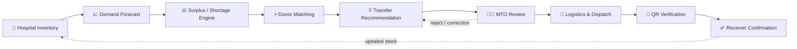
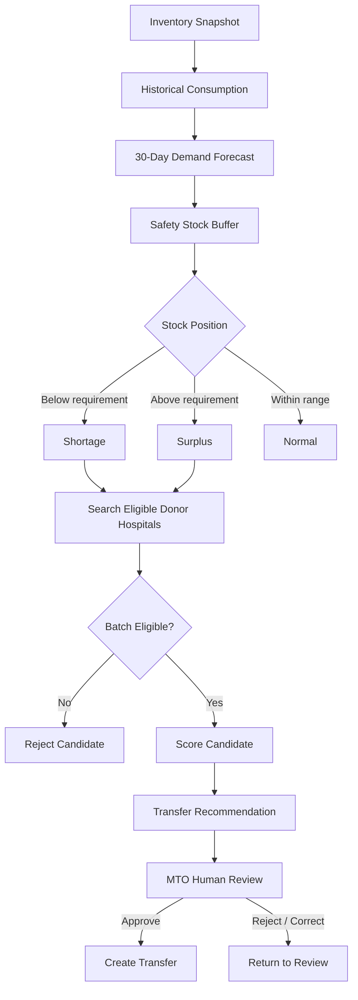
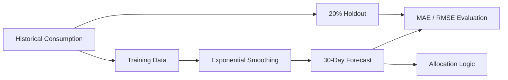
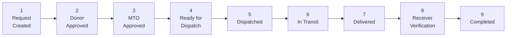
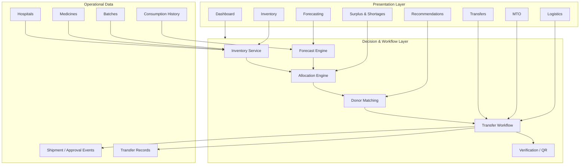
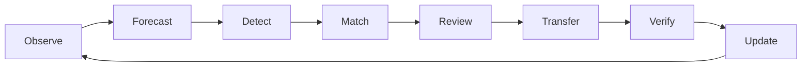
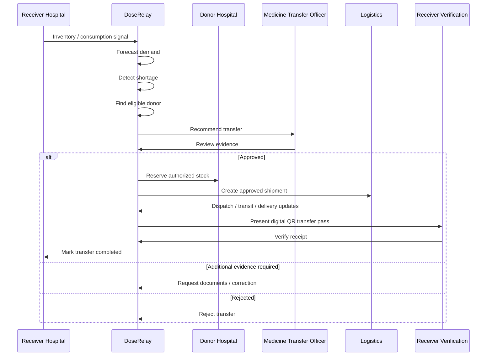

<div align="center">

# 💊 DoseRelay

### Intelligent Medicine Redistribution Across Healthcare Networks

**Forecast demand · Detect shortages · Match surplus · Approve safely · Transfer with traceability**

<br>

`AI-assisted decision support` · `Inventory intelligence` · `MTO approval workflow` · `QR-backed chain of custody`

<br>

**DoseRelay helps healthcare networks move the right medicine, from the right hospital, to the right place — before stock expires in one facility or runs short in another.**

<br>

[Overview](#-overview) · [How It Works](#-how-doserelay-works) · [Architecture](#-system-architecture) · [Core Modules](#-core-modules) · [Transfer Flow](#-end-to-end-transfer-lifecycle) · [Safety](#-safety--governance)

</div>

---

## ✦ Overview

Hospitals can face two opposite inventory problems at the same time:

- one facility may hold **surplus medicine** that is approaching expiry,
- another may face a **shortage of the same medicine**,
- and the information needed to coordinate a safe transfer may be scattered across teams and systems.

**DoseRelay turns that fragmented process into one coordinated workflow.**

It combines hospital inventory, batch-level expiry information, historical consumption, demand forecasting, surplus/shortage analysis, donor matching, Medicine Transfer Officer (MTO) review, logistics tracking, and QR-based verification into a single medicine redistribution platform.

> **Goal:** reduce avoidable medicine waste while helping hospitals respond to shortages earlier and with stronger operational traceability.

---

## ⚡ The Core Idea

```text
SURPLUS HOSPITAL                        SHORTAGE HOSPITAL
      │                                       ▲
      │ available stock                       │ required stock
      ▼                                       │
┌─────────────────┐                  ┌─────────────────┐
│  DoseRelay AI   │ ───────────────▶ │  Best Transfer │
│ Decision Layer  │                  │ Recommendation  │
└─────────────────┘                  └─────────────────┘
      │                                       │
      │ forecast + eligibility                │ review
      ▼                                       ▼
 Batch / Expiry                         MTO Approval
 Validation                                  │
      │                                       ▼
      └──────────────────────────────▶ Logistics
                                               │
                                               ▼
                                      QR Verification
```

DoseRelay does **not** treat medicine transfer as a simple stock movement. A recommendation has to survive the operational chain: inventory validation, forecast-based allocation, batch eligibility, human review, transfer approval, dispatch, delivery, and receipt verification.

---

## 🔄 How DoseRelay Works



The platform continuously connects three questions:

1. **What medicine is available right now?**
2. **What will each hospital likely need next?**
3. **Can an eligible surplus batch safely resolve another hospital's shortage?**

That creates a closed operational loop rather than an isolated forecasting dashboard.

---

## 🧮 Allocation Logic

DoseRelay exposes the logic behind its shortage and surplus calculations instead of hiding the decision behind a black box.

### Surplus

```text
Surplus = max(
    0,
    Available
    - Forecast(30 days)
    - Safety Stock(14 days)
    - Committed Stock
)
```

### Shortage

```text
Shortage = max(
    0,
    Required(30 days + 14 days)
    - Available
)
```

### Days of Cover

```text
Days of Cover =
Available Stock
───────────────
Average Daily Consumption
```

This gives users an interpretable basis for understanding **why** a hospital is marked as surplus, shortage, critical, or eligible as a donor.

---

## 🧠 Decision Pipeline



---

## 🧩 Core Modules

| Module | What it does | Why it matters |
|---|---|---|
| **Dashboard** | Presents the network's operational status at a glance | Gives decision-makers one starting point |
| **Inventory Management** | Organizes hospitals, medicines, and medicine batches | Creates a centralized stock view |
| **Demand Forecast** | Generates 30-day demand estimates from historical consumption | Helps detect risk before stock becomes critical |
| **Surplus & Shortages** | Calculates stock position, days of cover, shortage quantity, and donor availability | Converts raw inventory into actionable signals |
| **Recommendations** | Suggests donor → receiver transfers with quantity, priority, and eligibility context | Reduces manual donor searching |
| **Transfers** | Manages medicine requests and transfer progress | Keeps the entire movement auditable |
| **MTO** | Provides Medicine Transfer Officer review and approval controls | Keeps a human decision-maker in the loop |
| **Logistics** | Coordinates transporter assignment, dispatch, transit, and delivery updates | Connects digital approval with physical movement |
| **Digital QR Pass** | Creates a transfer-specific verification token | Supports on-site chain-of-custody verification |
| **Settings** | Supports platform-level configuration | Centralizes operational controls |

---

## 🏥 Inventory Intelligence

Inventory is managed at multiple levels rather than as one flat stock number.

### Hospital level

DoseRelay can organize facilities using information such as:

- hospital name and code,
- city / state,
- facility type,
- contact information,
- operational status,
- bed capacity.

### Medicine level

The platform maintains the medicine catalogue used across inventory, forecasting, shortage detection, and transfer workflows.

### Batch level

Batch-level visibility is especially important because redistribution decisions depend on more than total quantity.

DoseRelay tracks details such as:

- batch number,
- medicine,
- hospital,
- manufacturing date,
- expiry date,
- quantity,
- reserved quantity,
- batch status,
- days remaining before expiry.

Statuses shown by the platform include conditions such as:

`Normal` · `Approaching Expiry` · `Critical` · `Expired` · `Quarantined`

That allows the system to reason about **usable stock**, not merely stock that exists in a database.

---

## 📈 Demand Forecasting

DoseRelay includes an AI-assisted demand forecasting layer for medicine consumption.

The interface currently demonstrates:

- hospital-specific forecasting,
- medicine-specific forecasting,
- a **30-day forecast horizon**,
- **Exponential Smoothing**,
- MAE evaluation,
- RMSE evaluation,
- a **20% holdout** for performance evaluation,
- forecast totals and average daily demand.



> Forecasts are **decision-support estimates**. Clinical and procurement decisions should continue to involve qualified personnel.

---

## 🚨 Shortage & Surplus Detection

The analysis layer converts forecast and inventory information into operational situations.

It can distinguish:

- **shortage situations**,
- **surplus situations**,
- **resolvable shortages** with eligible network donors,
- **unmatched shortages** that may require external procurement.

A shortage record can combine:

```text
Medicine
Hospital
Available quantity
30-day demand
Days of cover
Shortfall
Eligible donor count
Urgency
```

This matters because a shortage alone is not the final decision.

The next question is:

> **Can another hospital safely donate enough stock without creating a new shortage there?**

---

## 💡 Transfer Recommendations

DoseRelay converts donor matching into a decision-ready recommendation.

Each recommendation can show:

- priority,
- donor hospital,
- receiver hospital,
- medicine,
- quantity,
- reason for the recommendation,
- donor surplus,
- receiving hospital shortage,
- batch number,
- remaining shelf life,
- eligible available quantity,
- batch status.

The MTO can then either:

**Accept & Create Transfer** or **Reject**

This keeps the platform useful for automation while preserving human authority over the actual medicine movement.

---

## 🧑‍⚕️ MTO — Human-in-the-Loop Control

The **Medicine Transfer Officer** acts as the governance layer between an AI recommendation and an approved transfer.

An MTO can:

- review transfer evidence,
- inspect supporting documents,
- review facility details,
- check medicine and batch information,
- verify expiry and quantity,
- inspect storage / transport requirements,
- approve a transfer,
- reject a transfer,
- request additional documents,
- return a transfer for correction,
- cancel when required.

```mermaid
flowchart LR
    A["AI Recommendation"] --> B["MTO Review"]
    B --> C{"Decision"}

    C -->|Approve| D["Authorized Transfer"]
    C -->|Reject| E["Rejected"]
    C -->|Need Evidence| F["Request Documents"]
    C -->|Needs Fix| G["Return for Correction"]

    F --> B
    G --> B
```



### Why this matters

DoseRelay is designed as a **decision-support and coordination platform**, not as a replacement for statutory, institutional, pharmaceutical, or clinical approval.

---

## 🚚 End-to-End Transfer Lifecycle

A DoseRelay transfer is represented as a clear milestone sequence.



| Stage | Purpose |
|---|---|
| **1. Request Created** | Receiver-side medicine need becomes a transfer request |
| **2. Donor Approved** | Donor stock is authorized and can be reserved |
| **3. MTO Approved** | Transfer receives final operational review |
| **4. Ready for Dispatch** | Approved stock is prepared for shipment |
| **5. Dispatched** | Medicine leaves the donor facility |
| **6. In Transit** | Shipment is moving between facilities |
| **7. Delivered** | Shipment reaches the destination |
| **8. Receiver Verification** | Receiving facility verifies the handoff |
| **9. Completed** | Transfer closes successfully |

The timeline makes the current transfer state visible instead of reducing the process to a generic `"in progress"` status.

---

## 📱 Digital QR Transfer Pass

Each transfer can generate a **Digital Transfer Pass** associated with the specific movement.

The pass connects verification to information such as:

- transfer ID,
- medicine,
- quantity,
- batch,
- donor facility,
- receiver facility,
- verification token / URL.

```text
┌─────────────────────────────────────────┐
│        DoseRelay Transfer Pass          │
├─────────────────────────────────────────┤
│ Transfer ID : TR-XXXXXXXX               │
│ Medicine    : Paracetamol 650mg         │
│ Quantity    : 133 units                 │
│ Batch       : DEMO-1024                 │
│ Donor       : Hospital A                │
│ Receiver    : Hospital B                │
│                                         │
│              [ QR TOKEN ]               │
│                                         │
│        Scan to verify handoff            │
└─────────────────────────────────────────┘
```

The QR pass is not just a decorative code. In the workflow, it acts as a bridge between the digital transfer record and the physical handoff.

---

## 📦 Logistics & Chain of Custody

Once a transfer receives final approval, the logistics workflow can coordinate:

- assigned transporter / carrier,
- dispatch scheduling,
- dispatch updates,
- in-transit updates,
- expected delivery,
- actual delivery,
- receipt verification.

The current interface explicitly uses **manual shipment updates** and indicates that **live GPS is not connected**.

That distinction is important: the system should communicate what it actually verifies instead of implying telemetry that is not present.

---

## 🔐 Verification Before Transfer

A safe redistribution system should never approve stock simply because another hospital needs it.

DoseRelay's review workflow is designed around verification of:

```text
Facility
  ↓
Medicine
  ↓
Batch
  ↓
Expiry
  ↓
Available quantity
  ↓
Supporting evidence
  ↓
Storage / transport requirements
  ↓
Institutional / statutory requirements
  ↓
MTO decision
```

The interface also makes it explicit that:

> Internal approval does not replace statutory permission.

---

## 🏗 System Architecture



### Architectural principle

DoseRelay separates three responsibilities:

| Layer | Responsibility |
|---|---|
| **Inventory truth** | What stock and batches currently exist |
| **Decision support** | What is likely to be needed and where stock can be reallocated |
| **Controlled execution** | Who approved the movement and what happened during transfer |

That separation prevents a forecast from automatically becoming a physical transfer.

---

## 🔁 The DoseRelay Loop



**Observe → Forecast → Detect → Match → Review → Transfer → Verify → Update**

This is the core product loop.

---

## 🎯 What Makes DoseRelay Different

### 1. It connects waste and shortage as one problem

Most inventory views tell a hospital what **it** has.

DoseRelay is designed to ask what the **network** has — and whether one facility's surplus can safely resolve another facility's shortage.

### 2. Forecasting feeds an operational workflow

The forecast is not the end product.

It feeds:

**Forecast → shortage detection → donor match → recommendation → approval → transfer**

### 3. Batch-level eligibility matters

Medicine redistribution depends on expiry, available quantity, reservation state, and batch status — not only medicine name.

### 4. Human approval remains central

AI can surface and rank opportunities, while the MTO retains decision authority.

### 5. Transfers stay traceable

The platform carries the recommendation into milestone tracking, logistics, delivery, receiver verification, and completion.

### 6. The reasoning is visible

The system exposes its formulas, stock position, donor context, expiry information, quantity, and recommendation rationale.

---

## 🌍 Expected Impact

DoseRelay is designed around three practical outcomes.

| Challenge | DoseRelay response |
|---|---|
| **Medicine expires where demand is low** | Identify transferable surplus before it becomes waste |
| **Hospitals discover shortages too late** | Use demand forecasting and days-of-cover signals |
| **Inter-hospital transfers are fragmented** | Coordinate recommendation, approval, logistics, and verification in one workflow |

The platform's value comes from **better utilization of stock that already exists inside a healthcare network**.

---

## 🧪 Example Scenario

Consider three hospitals:

```text
Metro General Hospital
Paracetamol 650mg
Available: 500 units
Forecast + safety requirement: 633 units
Shortage: 133 units
        │
        │ DoseRelay searches network
        ▼
Coastal Medical Hospital
Eligible surplus batch available
        │
        │ recommendation
        ▼
Transfer 133 units
        │
        ├── Donor approval
        ├── MTO review
        ├── Dispatch
        ├── Delivery
        └── QR-backed receiver verification
```

Instead of immediately creating a new procurement requirement, DoseRelay first asks whether the existing network can safely absorb the shortage.

---

## 🧭 Product Workflow



---

## 🛡 Safety & Governance

DoseRelay should be treated as a **healthcare operations decision-support system**.

It is not intended to:

- prescribe medicine,
- replace pharmacists,
- replace clinicians,
- override procurement policy,
- certify legal eligibility,
- replace statutory permissions,
- guarantee forecast accuracy.

A recommended transfer should remain subject to verification of:

**facility · licence · medicine · batch · expiry · quantity · storage · transport · supporting evidence · institutional requirements**

---

## 🧰 Implementation Principles

The UI demonstrates several principles that should remain true as the system evolves:

### Explainable before automatic

Users should be able to see why a shortage, surplus, or recommendation exists.

### Batch-aware before quantity-aware

A medicine may be available in total but still be unsuitable for transfer because of batch status or shelf life.

### Human-approved before dispatched

No AI recommendation should silently become an operational shipment.

### Traceable before completed

Approvals, milestones, transport updates, and receiver verification should remain tied to the same transfer record.

### Explicit about system limits

If updates are manual, say they are manual.  
If GPS is not connected, do not imply live tracking.  
If a forecast is an estimate, label it as an estimate.

---

## 🗂 Suggested Repository Structure

The README does not assume a specific framework, but the product naturally separates into these concerns:

```text
DoseRelay/
│
├── frontend/            # dashboards and workflow interfaces
├── backend/             # application APIs and business logic
├── forecasting/         # demand forecasting logic
├── allocation/          # surplus / shortage calculations
├── recommendations/     # donor matching and ranking
├── transfers/           # approval and transfer state machine
├── logistics/           # dispatch and delivery events
├── verification/        # QR / token verification
├── database/            # hospital, medicine, batch and transfer data
└── README.md
```

Use your actual repository structure in place of this conceptual layout.

---

## 🚀 Running the Project

The screenshots alone do not reliably identify the project's framework, package manager, database, environment variables, or startup commands.

Rather than publishing incorrect setup instructions, keep the real commands from the repository here:

```bash
# 1. Clone
git clone <your-repository-url>
cd <your-project-folder>

# 2. Install dependencies
<your-install-command>

# 3. Configure environment
<your-environment-setup>

# 4. Start the application
<your-start-command>
```

> Replace the four placeholders above with the repository's real commands before publishing.

---

## 🗺 Roadmap

```text
Current Product
├── Centralized hospital inventory
├── Medicine catalogue
├── Batch / expiry visibility
├── 30-day demand forecasting
├── Surplus & shortage detection
├── Donor matching
├── Transfer recommendations
├── MTO approval workflow
├── Transfer milestones
├── Logistics management
└── Digital QR transfer pass

Potential Extensions
├── Live carrier / GPS integration
├── Temperature / cold-chain telemetry
├── Multi-network deployment
├── Advanced forecast models
├── Procurement-system integration
├── Notification / escalation engine
└── Network-wide optimization
```

Potential extensions are future directions, not claims about the current implementation.

---

## 💙 Product Vision

> **A medicine should not expire unused in one hospital while another hospital in the same network is running short of it.**

DoseRelay turns that idea into a measurable workflow:

```text
Know the stock.
Predict the need.
Find the surplus.
Verify the batch.
Approve the transfer.
Track the movement.
Verify the handoff.
```

<div align="center">

### DoseRelay

**Smarter Medicine Redistribution**

*Reduce waste. Anticipate shortages. Coordinate safer transfers.*

</div>
